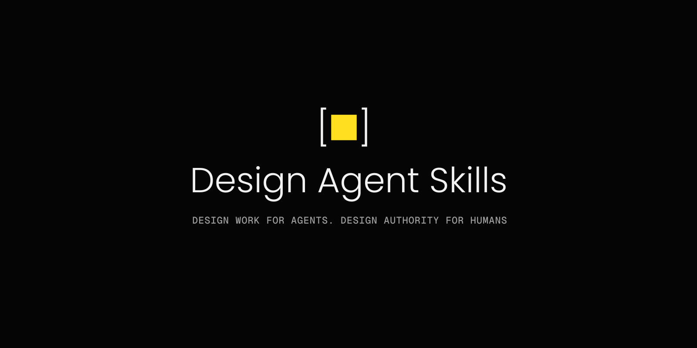

# Design Agent Skills

**Design work for agents. Design authority for humans.**

[](CHANGELOG.md)
[](docs/skills.md)

[](LICENSE)
[](docs/codex.md)

[Why DAS](#why-das-exists) · [Install](#install) · [Workflow](#how-the-work-flows) · [Skills](#choose-a-skill) · [Docs](#documentation) · [Contribute](CONTRIBUTING.md)

Design Agent Skills (DAS) gives Codex 16 Markdown skills and 12 shared references for the design work between a
product request and implementation. It helps the agent understand a product, inspect interfaces, develop and
compare designs, and give the implementer clear requirements. People retain control of consequential product and
design choices.

The skills work with your product context, design system, and tools. They carry observations, proposals,
approved decisions, and verification results between tasks while keeping those records distinct.

> Version 0.1.0 supports the documented Codex app and CLI workflows. Claude support is under development and is not included in this release's supported configurations. See the [release notes](docs/release-notes.md) and [tested configurations](docs/advanced-installation.md#support-and-evidence).

## Why DAS exists

DAS helps the agent do the design work between product intent and implementation: recover the context, check
reuse, explore content, interaction, and visual choices, and recommend a direction. The agent then carries the
person's choice into implementation requirements and checks the built interface against them. The same methods
support improving an existing product or designing something new.

A coding agent can build a working interface while still getting the design wrong. When context is incomplete,
it may invent a recovery flow, overlook an existing component, choose a visual direction without alternatives,
or treat the current code as the approved design. Passing implementation tests does not settle those questions.

### What DAS adds

DAS works alongside your implementation tools, component libraries, and audits. It connects the design work from
product context and alternatives to an explicit human decision. The handoff makes approved requirements and
unresolved questions clear to the implementer; verification checks the built result against those requirements.

For a checkout redesign, the work could include finding an existing form pattern, comparing recovery flows,
developing the visual treatment, and handing the selected design to a coding agent. The design work and the
record of the person's choice travel together; the route depends on the task.


## Install

The native plugin installs all 16 skills for Codex app and CLI. You can also install project-local copies through Skills CLI. Use one route per project to avoid duplicate DAS entries.

If DAS is already installed, follow the [replacement instructions](docs/advanced-installation.md#replace-an-earlier-installation) first. Local development packages, RC1, and 0.1.0 share the plugin identity and version; the source identifies which package you have.

### Codex plugin quick start

In your terminal:

```sh
codex plugin marketplace add vdigitaldesign/design-agent-skills --ref v0.1.0
codex plugin add design-agent-skills@design-agent-skills
codex plugin list
```

Open a new Codex session in your project. Select **Design Agent Skills: Design Router** from the skill picker, or use the namespaced invocation in a request:

```text
Use $design-agent-skills:design-router to review our checkout flow.

Read the existing screens, product rules, and design-system guidance.
Identify the main usability problems and recommend what to change.
Keep pricing, eligibility, and existing payment behavior unchanged.

Show me any material design choices before preparing a selected direction
for implementation. Save the findings and handoff in design/checkout/.
Do not edit product code.
```

Replace the flow, constraints, and destination with your task. Give Codex access to the relevant files or preview. The [task guide](docs/getting-started.md) includes a brief template and examples for new pages, existing flows, audits, visual direction, and implementation checks.

### Project-local skills

From the root of the project that will use DAS:

```sh
npx --yes skills@1.7.2 add https://github.com/vdigitaldesign/design-agent-skills/tree/v0.1.0 --agent codex --skill '*' --copy --yes
```

Standalone copies use `$design-router` in Codex, without the plugin prefix. The [installation guide](INSTALL.md) covers prerequisites, verified archive downloads, and existing installations. The [Codex guide](docs/codex.md) explains discovery and use; [advanced installation](docs/advanced-installation.md) covers replacement, removal, and troubleshooting.

## How the work flows

| Stage | The agent's work | What carries forward |
| --- | --- | --- |
| Understand | Recover product facts, design-system rules, assumptions, and gaps | A grounded task and its sources |
| Diagnose | Review behavior, content, layout, states, and accessibility; check reuse | Findings and options worth pursuing |
| Create | Develop distinct directions, make them tangible, and recommend one | Alternatives with benefits and costs |
| Decide | Ask for the consequential choice and record its exact scope | The person's decision and unresolved questions |
| Deliver and verify | Prepare requirements, hand off to implementation, and check the built result | Matches, differences, and useful design knowledge |

Work follows the task. A review may end with findings and recommendations. A new flow may need alternatives, a human choice, a design contract, and an implementation check. A correction already determined by an approved rule can go directly to a focused handoff. Design-system changes use the same care at the scope of a token, component, pattern, or migration.

### Where your decisions fit

The agent can research, audit, create, compare, and recommend within the scope you gave it. It asks for a decision when the remaining choice could change the product or design in a meaningful way, such as changing a task flow, recovery behavior, or visual identity.

Approval applies to the choice and scope you actually approved. Choosing a layout does not approve a new pricing rule. A prototype does not become the design system because someone built it. DAS keeps observed, proposed, approved, implemented, and verified records separate, and identifies which approved requirements apply to implementation.

Read [how DAS works](docs/how-das-works.md) for decision boundaries, design-system work, and the handoff to coding agents.

## Choose a skill

Use [`design-router`](skills/design-router/SKILL.md) when the task crosses several areas or you are unsure where to start. Invoke a specialist directly when the work is clear.

### Understand the task

| Skill | Use it to |
| --- | --- |
| [design-router](skills/design-router/SKILL.md) | Choose and continue the right design workflow |
| [frame-design-task](skills/frame-design-task/SKILL.md) | Clarify the goal, scope, constraints, and decisions |
| [reconstruct-design-context](skills/reconstruct-design-context/SKILL.md) | Recover product facts and unresolved questions from existing sources |

### Review what exists

| Skill | Use it to |
| --- | --- |
| [audit-design-surface](skills/audit-design-surface/SKILL.md) | Review usability, content, composition, states, and accessibility |
| [audit-design-system](skills/audit-design-system/SKILL.md) | Assess system coverage, consistency, and the work it needs |
| [assess-design-reuse](skills/assess-design-reuse/SKILL.md) | Compare existing components and patterns with custom work |

### Create and explore

| Skill | Use it to |
| --- | --- |
| [explore-design-directions](skills/explore-design-directions/SKILL.md) | Compare distinct solutions and recommend a direction |
| [develop-visual-direction](skills/develop-visual-direction/SKILL.md) | Develop composition, typography, imagery, color, and motion |
| [prototype-design-directions](skills/prototype-design-directions/SKILL.md) | Make a choice tangible through a prototype, mock, or wireframe |

### Carry decisions forward

| Skill | Use it to |
| --- | --- |
| [record-design-decision](skills/record-design-decision/SKILL.md) | Preserve the person's explicit choice and its scope |
| [evolve-design-system](skills/evolve-design-system/SKILL.md) | Prepare a focused change to tokens, components, patterns, or documentation |
| [publish-design-system-canon](skills/publish-design-system-canon/SKILL.md) | Publish an exact approved system revision to its designated destination |

### Deliver and check

| Skill | Use it to |
| --- | --- |
| [write-design-contract](skills/write-design-contract/SKILL.md) | Carry the applicable requirements and approved design into a contract and coding handoff |
| [validate-design-contract](skills/validate-design-contract/SKILL.md) | Find gaps and contradictions before implementation |
| [verify-design-implementation](skills/verify-design-implementation/SKILL.md) | Compare the built interface with approved requirements |
| [maintain-design-knowledge](skills/maintain-design-knowledge/SKILL.md) | Keep useful decisions and patterns findable and current |

The [skill catalog](docs/skills.md) adds the typical result for each capability. These are available capabilities, not a mandatory sequence or document checklist.

## Bring your product context

Provide the result you need, relevant product facts, existing decisions, files or previews, and constraints. State where the agent may work. It should inspect accessible sources before asking you to fill a gap, and continue work that does not depend on the missing answer.

Tools come from your Codex environment. Some tasks need a browser, design files, or an image tool; DAS does not bundle those services or a model runtime. Each skill carries its supporting references and related instructions. Keep the complete installed folders so the agent can open them. The [Codex guide](docs/codex.md) describes the supported setup.

## Scope

DAS supports design decisions across a workflow. It has no universal visual style and does not guarantee a beautiful interface or the right product strategy. Product judgment, research, and testing with users remain necessary.

The design skills can create prototypes and implementation specifications. Production UI and engineering architecture belong to the implementation work. A completed specification does not establish that the interface was built, deployed, or successful with users.

The release preserves the instruction sources used in the completed design-contract and approval-chain checks. Those results apply to their recorded tasks, models, and routes; they do not establish reliability across every skill or product. [Tested configurations and limits](docs/advanced-installation.md#support-and-evidence) explain the evidence behind the release.

## Documentation

| You want to | Read |
| --- | --- |
| Install DAS | [Installation](INSTALL.md), [Codex guide](docs/codex.md) |
| Give the agent a useful task | [Getting started](docs/getting-started.md) |
| Understand the workflow and your decisions | [How DAS works](docs/how-das-works.md) |
| Find a specialist and its expected output | [Skill catalog](docs/skills.md) |
| Update, remove, or restore an installation | [Advanced installation](docs/advanced-installation.md) |
| Check tested configurations and limitations | [Support and evidence](docs/advanced-installation.md#support-and-evidence) |
| Report a problem or request a capability | [Support](SUPPORT.md) |
| Report a suspected vulnerability privately | [Security reporting](SECURITY.md) |
| Propose a package or instruction change | [Contributing](CONTRIBUTING.md) |
| Review this release and package changes | [Release notes](docs/release-notes.md), [Changelog](CHANGELOG.md) |

## Repository layout

```text
skills/<name>/SKILL.md      Instructions for each of the 16 skills
references/                The 12 shared design references
skills/<name>/references/   Generated copies for standalone installation
skills/<name>/related/      Generated instructions from the other skills
assets/                    README, plugin, and repository artwork
.codex-plugin/             Codex plugin manifest
.agents/plugins/           Codex marketplace catalog
docs/                      Workflow, client guide, examples, catalog, release notes
scripts/manage.py          Check and build the distributable package
tests/                     Repository and packaging checks
.github/                   Contribution forms and automated checks
```

This repository contains the public release export. Maintainers carry accepted contributions into the development source before generating the next release. `TARGET.json` pins the instruction sources for this edition; changing those sources requires a new edition and evidence decision. [Contributing](CONTRIBUTING.md) explains how to propose changes and use the maintenance commands.

`VERSION`, `MANIFEST.json`, and `verify.py` identify and check the package. The contributor `AGENTS.md` and `CLAUDE.md` apply to work on this checkout; they do not add consumer instructions or Claude support to the installed skills.

## License

[MIT](LICENSE). Copyright (c) 2026 Volodymyr Onishchenko.
