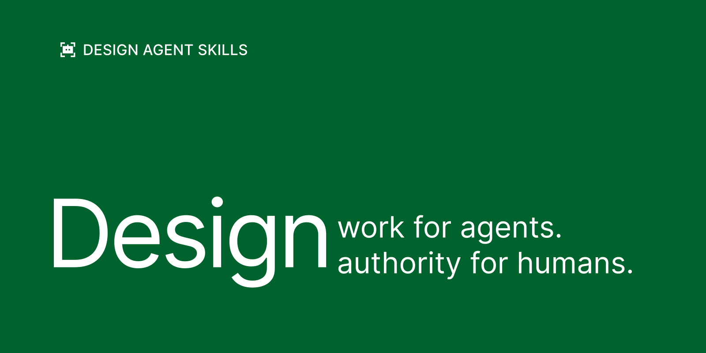

# Design Agent Skills

[](CHANGELOG.md)  [](LICENSE)

[Install](#install) · [Start a task](#start-a-task) · [Skills](#choose-a-skill) · [Documentation](#documentation) · [Contribute](CONTRIBUTING.md)

Design Agent Skills (DAS) helps you work through product and interface design with an AI agent. Use it to investigate a confusing screen, compare designs for a new flow, or prepare an approved design for implementation.

The agent works from your product sources, constraints, and design system. You retain authority over material product and design decisions. DAS is available for Codex and Claude Code from this repository.

## Why DAS exists

A coding agent can build a working interface while still getting the design wrong. When context is incomplete, it may invent a recovery flow, overlook an existing component, choose a visual direction without alternatives, or treat the current code as the approved design. Passing implementation tests does not settle those questions.

DAS connects design work to your product rules and design system. The skills help the agent check what can be reused, make important choices visible, and carry your approved decisions into a handoff. After implementation, it can compare the built interface with those requirements. Your engineering tools handle the production code.

The [worked example](packages/codex/docs/worked-example.md) follows a fictional ticket-reassignment task through three design options, a person's choice, and a developer handoff. It illustrates the process; it is not a report of a model run or a shipped interface.

## Install

[](packages/codex/docs/codex.md) [](packages/claude/docs/claude-code.md)

Choose your client and one installation route per project. Both native plugins include all 16 skills. Project-local copies are also available through Skills CLI.

If DAS is already installed, follow [update and removal](docs/update.md) before changing its source or version. For projects used by both clients, prefer the native plugins; copied skills share source-lock records by skill name.

### Codex plugin

In your terminal:

```sh
codex plugin marketplace add vdigitaldesign/design-agent-skills --ref v0.1.7 &&
codex plugin add design-agent-skills@design-agent-skills &&
codex plugin list
```

Open a new Codex session in your project. Select **Design Agent Skills: Design Router**, or invoke `$design-agent-skills:design-router`. The [Codex guide](packages/codex/docs/codex.md) covers the app and CLI workflows.

### Claude Code plugin

From your project, run:

```sh
claude plugin marketplace add 'vdigitaldesign/design-agent-skills#v0.1.7' --scope project &&
claude plugin install design-agent-skills@design-agent-skills --scope project &&
claude plugin list
```

Open a new Claude Code session and invoke `/design-agent-skills:design-router`. The [Claude Code guide](packages/claude/docs/claude-code.md) covers discovery and use. This scope does not include Claude Desktop or Cowork.

### Project-local skills

The [installation guide](INSTALL.md) has the prerequisites and exact Skills CLI commands for [Codex](INSTALL.md#codex-project-local-skills) and [Claude](INSTALL.md#claude-project-local-skills). Use the source path for your client: the destination agent flag alone does not select its instructions.

Copied skills use `$design-router` in Codex or `/design-router` in Claude Code, without the plugin prefix. Keep the complete installed folders so the agent can read their supporting references and related instructions.

## Start a task

Invoke Design Router for your installation, then provide a request such as:

```text
Review our checkout flow.

Read the existing screens, product rules, and design-system guidance.
Identify the main usability problems and recommend what to change.
Keep pricing, eligibility, and existing payment behavior unchanged.

Show me material design choices before preparing a selected direction
for implementation. Save the findings and handoff in design/checkout/.
Do not edit product code.
```

Replace the flow, constraints, and destination with your task. Provide the result you need, relevant product facts, existing decisions, and access to files or previews. State where the agent may work and save its output.

A request can end with an audit and recommendations, a comparison of directions, a prototype, or an implementation handoff. Specify the outcome you need. The [Codex task guide](packages/codex/docs/getting-started.md) has brief templates and examples; the [Claude Code guide](packages/claude/docs/claude-code.md) shows its invocation format.

## How the work flows

| Stage | The agent's work | What carries forward |
| --- | --- | --- |
| Understand | Recover product facts, design-system rules, assumptions, and gaps | A grounded task and its sources |
| Diagnose | Review behavior, content, layout, states, and accessibility; check reuse | Findings and options worth pursuing |
| Create | Develop distinct directions, make them tangible, and recommend one | Alternatives with benefits and costs |
| Decide | Ask for the consequential choice and record its exact scope | The person's decision and unresolved questions |
| Deliver and verify | Prepare requirements, hand off to implementation, and check the built result | Matches, differences, and useful design knowledge |

Work follows the task. A review may end with findings and recommendations. A new flow may need alternatives, a human choice, a design contract, and an implementation check. A correction already determined by an approved rule can go directly to a focused handoff. Design-system changes use the same care at the scope of a token, component, pattern, or migration.

### Where your decisions fit

The agent can research, audit, create, compare, and recommend within the scope you gave it. It asks for a decision when the remaining choice could change the product or design in a meaningful way, such as changing a task flow, recovery behavior, or visual identity.

Approval applies to the choice and scope you actually approved. Choosing a layout does not approve a new pricing rule. A prototype does not become the design system because someone built it. DAS distinguishes observed, proposed, approved, implemented, and verified work so the handoff can identify which requirements apply to implementation.

Human decisions are part of both client workflows. Before implementation, confirm the approved revision and any remaining product questions. Keep the handoff and its governing source files together when continuing in another chat.

Read the workflow guide for [Codex](packages/codex/docs/how-das-works.md) or [Claude](packages/claude/docs/how-das-works.md) for decision boundaries, design-system work, and the handoff to coding agents.

## Choose a skill

[](docs/skills.md)

Use `design-router` when the task crosses several areas or you are unsure where to start. Invoke a specialist directly when the work is clear. The [skill catalog](docs/skills.md) links to the instructions for each client.

### Understand the task

| Skill | Use it to |
| --- | --- |
| `design-router` | Choose and continue the right design workflow |
| `frame-design-task` | Clarify the goal, scope, constraints, and decisions |
| `reconstruct-design-context` | Recover product facts and unresolved questions from existing sources |

### Review what exists

| Skill | Use it to |
| --- | --- |
| `audit-design-surface` | Review usability, content, composition, states, and accessibility |
| `audit-design-system` | Assess system coverage, consistency, and the work it needs |
| `assess-design-reuse` | Compare existing components and patterns with custom work |

### Create and explore

| Skill | Use it to |
| --- | --- |
| `explore-design-directions` | Compare distinct solutions and recommend a direction |
| `develop-visual-direction` | Develop composition, typography, imagery, color, and motion |
| `prototype-design-directions` | Make a choice tangible through a prototype, mock, or wireframe |

### Carry decisions forward

| Skill | Use it to |
| --- | --- |
| `record-design-decision` | Preserve the person's explicit choice and its scope |
| `evolve-design-system` | Prepare a focused change to tokens, components, patterns, or documentation |
| `publish-design-system-canon` | Publish an exact approved system revision to its designated destination |

### Deliver and check

| Skill | Use it to |
| --- | --- |
| `write-design-contract` | Carry the applicable requirements and approved design into a contract and coding handoff |
| `validate-design-contract` | Find gaps and contradictions before implementation |
| `verify-design-implementation` | Compare the built interface with approved requirements |
| `maintain-design-knowledge` | Keep useful decisions and patterns findable and current |

These are available capabilities, not a mandatory sequence or document checklist. The client catalogs describe the typical result for each skill: [Codex](packages/codex/docs/skills.md), [Claude](packages/claude/docs/skills.md).

## Scope and limitations

DAS supports design decisions across a workflow. It has no universal visual style and does not guarantee a beautiful interface or the right product strategy. Product judgment, research, and testing with users remain necessary.

The skills can create prototypes and implementation specifications. Production UI and engineering architecture belong to implementation work. A completed specification does not establish that the interface was built, deployed, or successful with users.

Model behavior varies with the available context, tools, and settings. Review handoffs against your product rules. Claude outputs have omitted required behavior and confused review readiness with approval; compare contracts with their governing sources, especially exact content, permissions, failure and recovery paths, and acceptance checks. The complete contract and implementation-handoff workflow has limited behavioral verification on Claude.

Your agent environment supplies model access and tools. Some tasks need a browser, design files, or an image tool; DAS does not bundle those services or an application runtime. The client guides describe the documented setup and support limits.

## Documentation

| You want to | Read |
| --- | --- |
| Install DAS | [Installation](INSTALL.md), [Codex guide](packages/codex/docs/codex.md), [Claude Code guide](packages/claude/docs/claude-code.md) |
| Give the agent a useful task | [Codex task guide](packages/codex/docs/getting-started.md), [Claude Code first task](packages/claude/docs/claude-code.md) |
| See a brief, design choice, and developer handoff | [Worked example](packages/codex/docs/worked-example.md) |
| Understand the workflow and your decisions | [Codex workflow](packages/codex/docs/how-das-works.md), [Claude workflow](packages/claude/docs/how-das-works.md) |
| Find a specialist and its expected output | [Skill catalog](docs/skills.md), [Codex results](packages/codex/docs/skills.md), [Claude results](packages/claude/docs/skills.md) |
| Update, remove, or restore an installation | [Update and removal](docs/update.md) |
| Check client support and limitations | [Codex support](packages/codex/docs/advanced-installation.md#support-and-evidence), [Claude support](packages/claude/SUPPORT.md) |
| Report a problem or request a capability | [Support](SUPPORT.md) |
| Report a suspected vulnerability privately | [Security reporting](SECURITY.md) |
| Propose a package or instruction change | [Contributing](CONTRIBUTING.md) |
| Review release changes | [Changelog](CHANGELOG.md) |

## Repository layout

```text
.agents/plugins/           Codex marketplace catalog
.claude-plugin/            Claude marketplace catalog
packages/codex/            Complete Codex package, skills, references, and guides
packages/claude/           Complete Claude package, skills, references, and guides
assets/                    README, plugin, and repository artwork
docs/                      Client skill links and update guidance
scripts/manage.py          Check, synchronize, and build the client packages
tests/                     Common repository maintenance checks
.github/                   Contribution forms and automated checks
```

Each client package contains editable skill entrypoints, supporting references, and generated complete closures for project-local installation. Keep each client's instructions and resources together. `VERSION` and `MANIFEST.json` identify and check this repository; each package has its own source and integrity records. [Contributing](CONTRIBUTING.md) explains the maintenance commands.

## License

[MIT](LICENSE). Copyright (c) 2026 Volodymyr Onishchenko.
